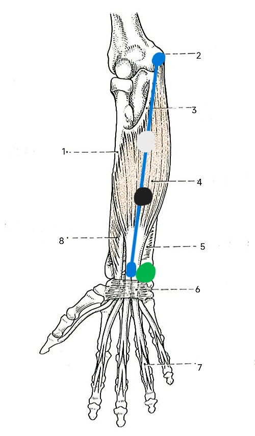
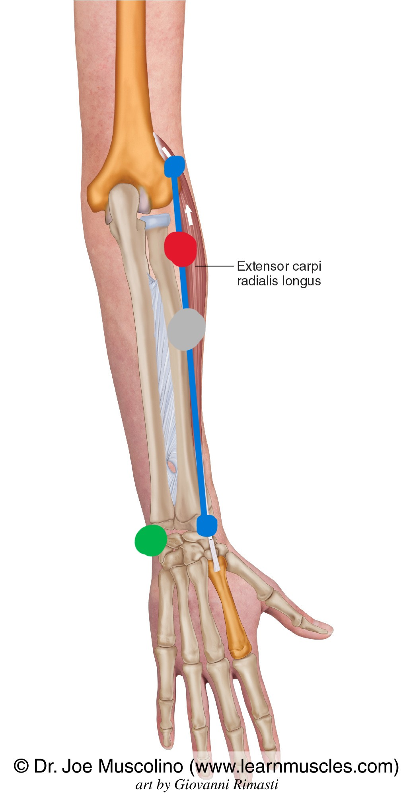

# Automated sEMG Motor Resonance Pipeline (Rock Climbing Study)

A comprehensive, automated experimental pipeline for a surface electromyography (sEMG) motor resonance study investigating neuromuscular activation patterns in expert rock climbers versus non-climbers during action observation (Cognitive Science Course 02455, DTU).

This repository contains the complete end-to-end system for:
1. **Stimulus standardization** (FFmpeg-based 1080p @ $30\text{ fps}$ precise duration locking).
2. **Experiment acquisition** (PsychoPy continuous zero-pause loop with squeeze-locked synchronization).
3. **Offline SD-card sEMG preprocessing** (handling `-1` timestamps via start/end calibration bookends and empirical sampling rate calibration).
4. **Signal analysis & feature extraction** (Clancy et al., 2002 4-stage filter cascade, robust baseline statistics, and multi-metric normalization).
5. **Statistical reporting** (Shapiro-Wilk normality, Levene's homoscedasticity, Parametric $2 \times 2$ Mixed ANOVA, Non-Parametric Aligned Rank Transform [ART] ANOVA, and Bonferroni simple main effects).
6. **Publication-grade visualization** (Raincloud plots, agonist-stabilizer co-activation correlations, grand-average time-course envelopes, and filter cascade showcases).

---

## Repository Structure

```text
dtu-02455-emg-climbing/
├── stimuli/                  # Video stimuli folder (climbing/ and everyday/)
├── data/
│   ├── logs/                 # PsychoPy *_events.csv session logs
│   ├── raw_shimmer/          # Raw Shimmer SD card CSV recordings
│   ├── epochs/               # Sliced dual-channel .pkl epochs & QC plots
│   ├── processed/            # Master feature tables & waveforms
│   └── stats_results/        # Statistical tables & publication figures
├── config.py                 # Central configuration (timing, channels, filters)
├── standardize_videos.py     # FFmpeg video standardization script
├── run_experiment.py         # PsychoPy continuous zero-pause experimental loop
├── preprocess_emg.py         # Slices continuous Shimmer traces using sync squeezes
├── postprocess_emg.py        # Clancy (2002) cascade, baseline norms & feature extraction
├── stats_analysis.py         # Shapiro-Wilk, Levene, Mixed ANOVA, ART, & Bonferroni tests
├── plot.py                   # Unified plotting suite & raw Shimmer file inspector
└── requirements.txt          # Python library dependencies
```

---

## Hardware & Electrode Placement Guide

The system uses a **Shimmer3 EXG unit** configured in dual-channel EMG mode to record simultaneously from the primary agonist and stabilizer forearm muscles:
* **Channel 1 (CH1):** *Flexor Digitorum Superficialis* (FDS) — Finger flexor (primary load-bearing agonist in rock climbing).
* **Channel 2 (CH2):** *Extensor Carpi Radialis* (ECR) — Wrist extensor and carpal stabilizer.
* **Reference / Ground:** Common-mode noise suppression electrode placed over an electrically neutral bony prominence.

### Shimmer 5-Lead Harness Mapping
* **White Lead (`CH1+`) & Black Lead (`CH1-`):** Placed $20\text{ mm}$ apart along the oblique reference line over the **FDS** muscle belly on the anterior (palm-up) forearm.
* **Red Lead (`CH2+`) & Grey Lead (`CH2-`):** Placed $20\text{ mm}$ apart along the top-outer ridge over the **ECR** muscle belly on the posterior (palm-down/handshake) forearm.
* **Green Lead (`Ref` / Ground):** Placed on the ulnar styloid process (pinky-side wrist bone) or olecranon (elbow tip).

### Anatomical Placement Diagrams

#### 1. *Flexor Digitorum Superficialis* (FDS) — Channel 1 (White & Black Leads)


#### 2. *Extensor Carpi Radialis* (ECR) — Channel 2 (Red & Grey Leads)


---

## Installation Guide (Lab PC Setup)

Open VS Code (or your terminal) in the directory where you want to store the project, then run:

```powershell
# 1. Clone the GitHub repository
git clone https://github.com/Kxlar/dtu-02455-emg-climbing.git
cd dtu-02455-emg-climbing

# 2. Create a Python virtual environment
python -m venv venv_ExpCogSc

# 3. Activate the virtual environment
# On Windows (PowerShell):
./venv_ExpCogSc/Scripts/Activate.ps1
# On Linux / macOS:
source venv_ExpCogSc/bin/activate

# 4. Install required libraries
pip install -r requirements.txt

# 5. Initialize directory structure
python config.py
```

---

## Pipeline Execution Workflow & Argparse Reference

### Step 1: Standardize Video Stimuli
Standardizes all climbing and everyday action video clips to identical dimensions ($1920 \times 1080$), frame rate ($30\text{ fps}$), color space (BT.709 sRGB), and exact duration ($4.000\text{ seconds} = 120\text{ frames}$). Supports `.mp4`, `.mov`, `.wmv`, etc.
```powershell
python standardize_videos.py
```

### Step 2: Run the Experiment (PsychoPy)
Launches the continuous zero-pause experiment. Press `SPACE` on the welcome screen to start. The experiment flows automatically from the **Start Squeeze ($t = 0.000\text{ s}$)** $\rightarrow$ **Settle** $\rightarrow$ **Resting Baseline** $\rightarrow$ **Video Trials + Jittered ISI** $\rightarrow$ **End Squeeze**.
```powershell
python run_experiment.py
```

### Step 3: Preprocess & Slice sEMG Recordings (`preprocess_emg.py`)
Automatically aligns offline Shimmer SD-card files (which record `-1` timestamps) using the start and end calibration squeezes, computes empirical sampling rates, and slices continuous data into dual-channel epoch files (`data/epochs/`).

**Available Command-Line Arguments (`argparse`):**
* `--events <path>`: Path to a specific PsychoPy `*_events.csv` log file.
* `--shimmer <path>`: Path to a specific raw Shimmer CSV file.
* `--fs <float>`: Override Shimmer sampling rate in Hz (default: `512.0`).
* `--manual-t0 <float>`: Manual override for Start Squeeze $t=0$ time (in seconds from file start).
* `--export-csvs`: Export each sliced trial epoch as an individual CSV segment.
* `--simulate-demo`: Generate synthetic dual-channel Shimmer files with `-1` timestamps and preprocess them automatically.

*Example:*
```powershell
python preprocess_emg.py --simulate-demo
```

### Step 4: Signal Analysis & Clancy Cascade (`postprocess_emg.py`)
Applies the 4-stage Clancy et al. (2002) filter cascade ($20\text{--}500\text{ Hz}$ bandpass, $50\text{ Hz}$ notch, full-wave rectification, $8\text{ Hz}$ low-pass linear envelope) and extracts normalized Peak Amplitude and Area Under the Curve (AUC) for both **FDS** and **ECR** independently.

**Available Command-Line Arguments (`argparse`):**
* `--file <path>`: Specific `*_epochs.pkl` participant file to process.
* `--demod <int>`: Demodulation law $d$ in Clancy et al. (2002): `1` = Full-Wave Rectification (MAV), `2` = Square-Law Root-Mean-Square (RMS). Default is `1`.
* `--simulate-demo`: Auto-generate demo Shimmer epochs if none exist and run full postprocessing.

*Example:*
```powershell
python postprocess_emg.py --demod 1
```

### Step 5: Statistical Analysis (`stats_analysis.py`)
Runs Shapiro-Wilk normality tests, Levene's homoscedasticity tests, Parametric $2 \times 2$ Mixed Factorial ANOVA, Non-Parametric Aligned Rank Transform (ART) ANOVA, Bonferroni-corrected simple main effects, and one-sample baseline equivalence tests.

**Available Command-Line Arguments (`argparse`):**
* `--subj-table <path>`: Path to `master_subject_level_anova_table.csv`.
* `--trial-table <path>`: Path to `master_trial_level_features.csv`.
* `--simulate-demo`: Run the statistical suite on a simulated $N=64$ dual-channel dataset.

*Example:*
```powershell
python stats_analysis.py --simulate-demo
```

### Step 6: Visualization & Raw Inspector (`plot.py`)

#### A. Inspect Raw Shimmer SD Files
You can directly inspect any raw Shimmer recording (`.csv`) on the lab PC to view raw waveforms, 8 Hz envelopes, accelerometer traces, and filter cascades:
```powershell
python plot.py --raw-shimmer ./data/raw_shimmer/sub-E41CB9_Shimmer_9BF9_Calibrated_SD.csv
```

#### B. Generate Publication Figures for the Report
Generates raincloud interaction plots, agonist-stabilizer co-activation plots (`FDS` vs. `ECR`), grand average time-course envelopes, trial stability checks, and filter cascade showcases in `data/stats_results/figures/`.
```powershell
python plot.py
```

**Available Command-Line Arguments (`argparse`) for `plot.py`:**
* `--raw-shimmer <path>`: Path to raw Shimmer CSV file for signal inspection.
* `--fs <float>`: Sampling rate in Hz when inspecting raw Shimmer file (default: `512.0`).
* `--no-show`: Save raw Shimmer inspection plots directly to disk without opening an interactive GUI window.
* `--subj-table <path>`: Path to subject-level ANOVA table.
* `--trial-table <path>`: Path to trial-level feature table.
* `--out-dir <path>`: Custom output directory for generated figures.
* `--simulate-demo`: Generate all publication figures using simulated data.

---

## Quick Testing (Demo Mode)

If you want to test the entire pipeline on a newly installed lab computer without hardware recordings, run:
```powershell
python preprocess_emg.py --simulate-demo
python postprocess_emg.py
python stats_analysis.py
python plot.py
```